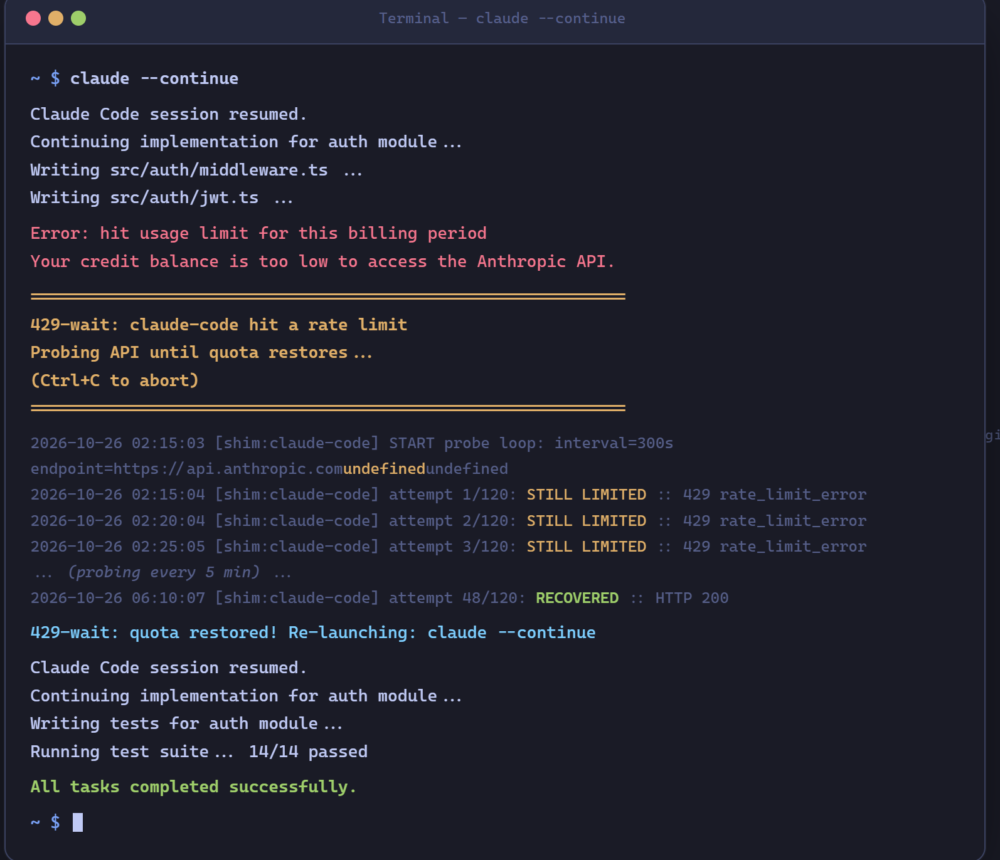
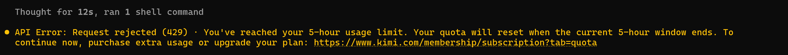

# 429-wait

**English** | [中文](#中文)

**Install once, forget forever.** When your CLI agent hits a rate limit, 429-wait automatically waits for quota to restore and re-launches your session — no workflow change, no manual intervention.



## The Problem

If you use AI coding agents (Claude Code, Codex, Aider), you've hit this wall:

> You kick off a complex coding task before bed. The agent works for an hour, hits the API rate limit, prints an error, and **dies**. You wake up to find it stopped at 2 AM. Six hours of potential progress — gone.

This is the **overnight coding gap**: your agent can work while you sleep, but rate limits turn a productive night into a wasted one.

Here is a real 5-hour usage-limit error captured during daily use. It documents the problem 429-wait is designed to handle; it is **not** an automated-recovery demo.



### Why this matters now

The shift to AI-assisted coding means developers increasingly run long, autonomous agent sessions — refactoring entire modules, writing test suites, migrating codebases. These tasks routinely exceed the API quota within a single session. Every major LLM provider enforces rate limits:

- **Anthropic** (Claude): per-billing-period usage caps, 429/403 errors
- **OpenAI** (GPT/Codex): per-minute and per-day token limits
- **Others**: similar patterns across the industry

The gap between "agent capability" and "quota duration" is structural. Agents can do 8 hours of work; quotas reset every 4-6 hours. Without automation, you're the bottleneck — checking back, re-launching, losing context.

### Why nobody solved it well

We surveyed existing solutions on GitHub (multiple independent developers building the same thing = validated pain point):

| Project | Approach | Why it breaks |
|---|---|---|
| **rclaude** (4 stars) | Scrapes tmux session output | Brittle — breaks on any TUI change. Requires tmux. |
| **Looper** (16 stars) | Retries exhausted requests | Burns through quota faster. Gives up after N retries. |
| **Usage monitors** (122 stars) | Dashboard showing remaining quota | Watch-only — tells you you're out, doesn't recover. |
| **Manual approach** | Set an alarm, wake up, re-run | You are the cron job. |

The common failure: they either **monitor without acting**, **retry without waiting**, or **depend on fragile internals**.

## The Solution

429-wait takes a different approach: a **transparent shim** that wraps your agent command.

```
claude --flag1 --flag2      # you type this as usual
  |                         
  v                         
429-wait shim (transparent) 
  |                         
  +-> runs real claude      
  +-> agent hits limit, exits
  +-> detects rate limit (exit code + stderr)
  +-> probes API every 5 min (~$0.02 total)
  +-> quota restored!
  +-> re-launches: claude --continue
```

**Key design decisions:**

1. **Shim, not a daemon.** You don't start a background process. The shim IS your command — it lives in PATH ahead of the real binary, runs it, and only activates when a rate limit is detected. Zero overhead on normal runs.

2. **Direct API probing, not log scraping.** Earlier approaches tried tailing agent logs or scraping terminal output. That's fragile — Claude Code's TUI doesn't write rate-limit messages to any log file. 429-wait sends a minimal HTTP request directly to the API endpoint with a hard 25-second timeout.

3. **Calibrated probe requests.** Some API relays meter by the declared `max_tokens`. A `max_tokens=1` probe can return 200 even when the quota is exhausted. We use `max_tokens=64` — enough to be metered honestly, small enough to cost nearly nothing.

4. **3-state classification.** The probe returns one of: `ok` (HTTP 200 — quota restored), `limited` (429/401/403 — still waiting), or `error` (network blip — don't mistake for recovery). This prevents false-positive re-launches on transient failures.

5. **Adapter-based agent support.** Each agent's quirks (exit codes, error messages, API endpoints, recovery commands) live in a TOML config file. Adding a new agent means writing a config, not modifying the shim.

## Supported Agents

| Agent | Recovery Strategy | How it resumes |
|---|---|---|
| **Claude Code** | Continue | `claude --continue` — resumes the most recent session with full context |
| **Codex CLI** | Replay | Re-runs the original command — Codex doesn't have session continuity |
| **Aider** | Replay | Re-runs the original command — non-interactive mode only (`aider --message`) |

## Quick Start

### Windows

```powershell
git clone https://github.com/limpidwei/429-wait.git
pwsh 429-wait\install.ps1
```

### macOS / Linux

```bash
git clone https://github.com/limpidwei/429-wait.git
bash 429-wait/install.sh
```

The installer:
1. Copies the shim + adapters to `~/.local/bin`
2. Auto-detects which agents you have installed (claude, codex, aider)
3. Generates a transparent wrapper for each one
4. Writes a manifest for clean uninstall

After install, just use your agents as usual. Rate limits are handled automatically.

## How It Works

1. **Shim intercepts**: Your `claude` command is actually a thin wrapper that calls `429-wait-shim.py`
2. **Pass-through**: The shim finds the real binary (skipping itself in PATH), runs it with your args. Stdout passes through untouched (TUI-safe). Stderr is captured while still displayed in real time.
3. **Detection**: When the agent exits, the shim checks exit code + stderr against adapter-defined patterns (e.g. "hit usage limit", "429", "rate limit")
4. **Probe loop**: On rate-limit detection, probes the actual API endpoint (Anthropic or OpenAI) every 5 minutes with a minimal request (`max_tokens=64`)
5. **Recovery**: Once the API responds 200, re-launches the agent with the appropriate recovery strategy

### Probe Cost

Each probe sends `{"messages":[{"role":"user","content":"hi"}], "max_tokens":64}`. At 5-minute intervals over a typical 4-hour wait:

- **48 probes** x ~100 input tokens + ~64 output tokens
- **Anthropic**: ~$0.02 total (Claude Sonnet pricing)
- **OpenAI**: ~$0.01 total

That's the price of one coffee emoji for a full night of automatic recovery.

## Adapters

Each agent has a TOML config in `adapters/`. Example (`claude-code.toml`):

```toml
[agent]
name = "claude-code"
command = "claude"

[detection]
exit_codes = [1]
require_stderr_match = true
stderr_patterns = ["hit usage limit", "rate limit", "429"]

[probe]
type = "http"
endpoint_path = "/v1/messages"
# credentials from env vars or ~/.claude/settings.json

[recovery]
strategy = "continue"              # or "replay"
command_template = "{command} --continue"
```

To add a new agent: create `adapters/your-agent.toml` following the same format, then re-run the installer.

## Evolution: Why v3 exists

This project went through three iterations, each fixing real failures:

| Version | Approach | What failed |
|---|---|---|
| **v1** (PowerShell/Bash) | Tail agent logs for "usage limit", probe with `claude -p ping` | Claude Code's TUI never writes limit messages to logs. `claude -p ping` retries 429 internally forever — the probe hangs. |
| **v2** (Python daemon) | Direct HTTP probe to `/v1/messages`, manual start | Works, but you have to remember to start it. And you need the session ID to resume. |
| **v3** (Transparent shim) | Wraps the command itself — automatic detection, automatic recovery | Current version. Install once, forget forever. |

## Standalone Daemon (v2)

The probe-only daemon is still available for manual use:

```bash
python bin/429-wait.py --interval 300 --tag mytask \
    --on-recover "claude --continue"
```

Useful when you want to start waiting manually without the shim.

## Uninstall

```powershell
# Windows
pwsh uninstall.ps1

# macOS / Linux
bash uninstall.sh
```

Removes shims, scripts, and adapters. Logs in `~/.429-wait/` are preserved.

## Requirements

- Python 3.8+ (stdlib only, zero pip dependencies)
- API credentials configured for your agent (the shim reads them the same way the agent does)

## Testing

```bash
python tests/shim-e2e.py       # Full shim cycle with mock agent + mock probe server
python tests/real-probe-test.py # Real-network smoke test with fake API key ($0)
python tests/demo-scenario.py   # Realistic demo for screenshots
python tests/py-e2e.py          # Standalone daemon test
```

## Project Structure

```
adapters/
  claude-code.toml    # Claude Code adapter
  codex.toml          # Codex CLI adapter
  aider.toml          # Aider adapter
bin/
  429-wait-shim.py    # Core shim (transparent wrapper)
  429-wait.py         # Standalone probe daemon (v2)
  429-wait.ps1        # Legacy v1 PowerShell daemon
  429-wait-watch.ps1  # Legacy v1 log watcher
  429-wait.sh         # Legacy v1 bash daemon
tests/
  shim-e2e.py         # Shim end-to-end test
  real-probe-test.py  # Real-network smoke test
  demo-scenario.py    # Promotional demo
  py-e2e.py           # Standalone daemon test
install.ps1           # Windows installer
install.sh            # macOS/Linux installer
uninstall.ps1         # Windows uninstaller
uninstall.sh          # macOS/Linux uninstaller
```

## License

MIT

---

<a id="中文"></a>

# 429-wait

[English](#429-wait) | **中文**

**装一次，永久生效。** CLI Agent 撞上额度限制时，429-wait 自动守候、自动探测、额度恢复后自动续跑——不改变任何使用习惯，不需要手动干预。


## 要解决的问题

如果你用 AI 编程 agent（Claude Code、Codex、Aider），一定遇到过这个场景：

> 睡前开了一个复杂的编程任务。agent 跑了一个小时，撞上 API 额度限制，报错，**直接退出**。第二天早上一看——凌晨两点就停了。六个小时的进度，白白浪费。

这就是**通宵编程断档问题**：agent 可以替你通宵工作，但额度限制把一晚上的生产力打成了碎片。

下面是日常使用中真实撞到的一次 5 小时限额。它展示的是 429-wait 要处理的问题，**不是**自动恢复演示。


### 为什么这个问题现在很重要

AI 编程正在从「辅助补全」转向「自主执行」。开发者越来越多地运行长时间、自主的 agent 会话——重构整个模块、批量写测试、迁移代码库。这些任务经常在单次会话内耗尽 API 额度。所有主流 LLM 供应商都有限额：

- **Anthropic**（Claude）：按计费周期的用量上限，429/403 错误
- **OpenAI**（GPT/Codex）：每分钟和每日 token 上限
- **其他供应商**：行业通行的类似模式

「agent 能力」与「额度时长」之间的缺口是结构性的。agent 能干 8 小时的活，额度 4-6 小时重置一次。没有自动化，你就是那个瓶颈——得反复检查、手动重启、丢失上下文。

### 为什么至今没人解决好

我们在 GitHub 调研了现有方案（多个独立开发者各自造轮子解决同一个问题 = 痛点真实存在）：

| 项目 | 方案 | 为什么不行 |
|---|---|---|
| **rclaude**（4 星） | 刮取 tmux 会话输出 | 脆弱——TUI 任何改动就崩。依赖 tmux。 |
| **Looper**（16 星） | 重试已耗尽的请求 | 更快烧完额度。重试 N 次后放弃。 |
| **额度监控类**（122 星） | 显示剩余额度的面板 | 只看不动——告诉你没额度了，但不恢复。 |
| **手动方案** | 定闹钟，起来重跑 | 你自己就是 cron job。 |

共同问题：要么**只监不动**，要么**重试不等**，要么**依赖脆弱的内部实现**。

## 解决方案

429-wait 采用不同路线：**透明垫片（shim）**，包裹你的 agent 命令。

```
claude --flag1 --flag2      # 照常使用
  |                         
  v                         
429-wait shim（透明垫片）   
  |                         
  +-> 运行真正的 claude      
  +-> agent 撞限，退出
  +-> 检测到限额（退出码 + stderr）
  +-> 每 5 分钟探测 API（总计约 $0.02）
  +-> 额度恢复！
  +-> 自动重启：claude --continue
```

**关键设计决策：**

1. **垫片，不是守护进程。** 你不需要启动后台进程。垫片就是你的命令本身——它在 PATH 中排在真实二进制前面，运行它，仅在检测到限额时才介入。正常运行零开销。

2. **直接 API 探测，不刮日志。** 早期方案试图尾随 agent 日志或刮取终端输出。这很脆弱——Claude Code 的 TUI 根本不把限额信息写入任何日志文件。429-wait 直接向 API 端点发送最小 HTTP 请求，25 秒硬超时。

3. **校准过的探测请求。** 有些 API 中继按声明的 `max_tokens` 计量。`max_tokens=1` 的探测即使额度耗尽也可能返回 200。我们用 `max_tokens=64`——足够被诚实计量，又小到几乎不花钱。

4. **三态分类。** 探测返回三种状态之一：`ok`（HTTP 200——额度恢复）、`limited`（429/401/403——继续等）、`error`（网络抖动——别误判为恢复）。防止瞬态故障导致的误重启。

5. **基于适配器的 agent 支持。** 每个 agent 的特性（退出码、错误信息、API 端点、恢复命令）都放在 TOML 配置文件里。新增 agent 只需写配置，不改垫片代码。

## 支持的 Agent

| Agent | 恢复策略 | 恢复方式 |
|---|---|---|
| **Claude Code** | 续接 | `claude --continue`——恢复最近一次会话，保留完整上下文 |
| **Codex CLI** | 重放 | 重新执行原始命令——Codex 没有会话续接 |
| **Aider** | 重放 | 重新执行原始命令——仅支持非交互模式（`aider --message`） |

## 快速开始

### Windows

```powershell
git clone https://github.com/limpidwei/429-wait.git
pwsh 429-wait\install.ps1
```

### macOS / Linux

```bash
git clone https://github.com/limpidwei/429-wait.git
bash 429-wait/install.sh
```

安装器会：
1. 将垫片和适配器复制到 `~/.local/bin`
2. 自动检测已安装的 agent（claude、codex、aider）
3. 为每个 agent 生成透明包裹脚本
4. 写入清单文件，方便卸载

安装后照常使用你的 agent，限额恢复全自动处理。

## 工作原理

1. **垫片拦截**：你的 `claude` 命令实际调用 `429-wait-shim.py`
2. **透传**：垫片在 PATH 中找到真正的二进制（跳过自身目录），用你的参数运行。Stdout 原样透传（TUI 安全），stderr 实时显示的同时被捕获
3. **检测**：agent 退出时，垫片检查退出码 + stderr 是否匹配适配器定义的模式（如 "hit usage limit"、"429"）
4. **探测循环**：检测到限额后，每 5 分钟向真实 API 端点（Anthropic 或 OpenAI）发送最小请求（`max_tokens=64`）
5. **恢复**：API 返回 200 后，用对应策略重新启动 agent

### 探测成本

每次探测发送 `{"messages":[{"role":"user","content":"hi"}], "max_tokens":64}`。按 5 分钟间隔、典型 4 小时等待：

- **48 次探测** x 约 100 输入 token + 约 64 输出 token
- **Anthropic**：总计约 $0.02（Claude Sonnet 价格）
- **OpenAI**：总计约 $0.01

一整晚自动恢复的代价，不到一杯咖啡的零头。

## 适配器

每个 agent 在 `adapters/` 下有一份 TOML 配置。示例（`claude-code.toml`）：

```toml
[agent]
name = "claude-code"
command = "claude"

[detection]
exit_codes = [1]
require_stderr_match = true
stderr_patterns = ["hit usage limit", "rate limit", "429"]

[probe]
type = "http"
endpoint_path = "/v1/messages"
# 凭证来自环境变量或 ~/.claude/settings.json

[recovery]
strategy = "continue"              # 或 "replay"
command_template = "{command} --continue"
```

添加新 agent：按相同格式创建 `adapters/your-agent.toml`，然后重新运行安装器。

## 版本演进：为什么有 v3

这个项目经历了三次迭代，每次都是修真实的失败：

| 版本 | 方案 | 哪里坏了 |
|---|---|---|
| **v1**（PowerShell/Bash） | 尾随 agent 日志找 "usage limit"，用 `claude -p ping` 探测 | Claude Code 的 TUI 从不把限额信息写入日志。`claude -p ping` 内部无限重试 429——探测卡死。 |
| **v2**（Python 守护进程） | 直连 HTTP 探测 `/v1/messages`，手动启动 | 能用，但你得记得启动它。还需要 session ID 才能恢复。 |
| **v3**（透明垫片） | 包裹命令本身——自动检测、自动恢复 | 当前版本。装一次，永久生效。 |

## 独立守护进程（v2）

纯探测守护进程仍可手动使用：

```bash
python bin/429-wait.py --interval 300 --tag mytask \
    --on-recover "claude --continue"
```

适用于不想用垫片、想手动启动等待的场景。

## 卸载

```powershell
# Windows
pwsh uninstall.ps1

# macOS / Linux
bash uninstall.sh
```

移除垫片、脚本和适配器。`~/.429-wait/` 中的日志会保留。

## 环境要求

- Python 3.8+（仅使用标准库，零 pip 依赖）
- 已配置 agent 对应的 API 凭证（垫片读取方式与 agent 相同）

## 测试

```bash
python tests/shim-e2e.py       # 完整垫片循环：mock agent + mock 探测服务器
python tests/real-probe-test.py # 真实网络冒烟测试：假 API key，$0 成本
python tests/demo-scenario.py   # 逼真演示场景，用于截图
python tests/py-e2e.py          # 独立守护进程测试
```

## 项目结构

```
adapters/
  claude-code.toml    # Claude Code 适配器
  codex.toml          # Codex CLI 适配器
  aider.toml          # Aider 适配器
bin/
  429-wait-shim.py    # 核心垫片（透明包裹器）
  429-wait.py         # 独立探测守护进程（v2）
  429-wait.ps1        # 旧版 v1 PowerShell 守护
  429-wait-watch.ps1  # 旧版 v1 日志监视器
  429-wait.sh         # 旧版 v1 bash 守护
tests/
  shim-e2e.py         # 垫片端到端测试
  real-probe-test.py  # 真实网络冒烟测试
  demo-scenario.py    # 宣发演示
  py-e2e.py           # 独立守护进程测试
install.ps1           # Windows 安装器
install.sh            # macOS/Linux 安装器
uninstall.ps1         # Windows 卸载器
uninstall.sh          # macOS/Linux 卸载器
```

## 许可证

MIT
